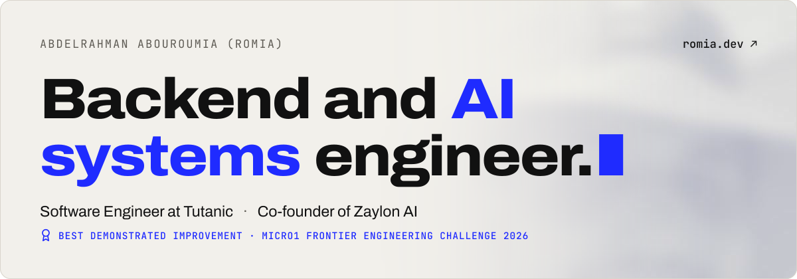

  <a href="https://romia.dev">
    <picture>
      <source media="(prefers-color-scheme: dark)" srcset="assets/header-dark.svg">
      
    </picture>
  </a>

At Tutanic I work on microservices, event streaming and the Kubernetes they deploy to. At [Zaylon AI](https://zaylon.ai) I built the agent that sells over WhatsApp and Instagram in the customer's own dialect. [AdvisoryDrift](https://github.com/Ab-Romia/advisorydrift) won Best Demonstrated Improvement at the micro1 Frontier Engineering Challenge 2026.

[romia.dev](https://romia.dev) &nbsp;·&nbsp; [LinkedIn](https://linkedin.com/in/abdelrahman-abouroumia) &nbsp;·&nbsp; [aabouroumia@gmail.com](mailto:aabouroumia@gmail.com)
