  

#### `~/now`

Co-founded [Zaylon AI](https://zaylon.ai): an agent that sells for merchants over WhatsApp and Instagram, from the first question to a confirmed payment.

#### `~/skills`

| Skill | Proof |
| --- | --- |
| Event-driven microservices: Kafka, sagas, transactional outbox | [Virtual-Bank-System](https://github.com/Ab-Romia/Virtual-Bank-System) · [write-up](https://romia.dev/blog/event-driven-bank-transfer-saga) |
| AI agents and tool calling | [Zaylon AI](https://zaylon.ai) · [advisorydrift](https://github.com/Ab-Romia/advisorydrift), won micro1's Best Demonstrated Improvement |
| Retrieval and RAG evaluation | [talos](https://github.com/Ab-Romia/talos) · [ContextIQ-RAG](https://github.com/Ab-Romia/ContextIQ-RAG) · [write-up](https://romia.dev/blog/talos-rag-retrieval-evaluation) |
| ML evaluation without leakage | [RAVDESS-emotion-recognition](https://github.com/Ab-Romia/RAVDESS-emotion-recognition) · [write-up](https://romia.dev/blog/speaker-leakage-ravdess) |
| Shipping Python packages | [commentdraft on PyPI](https://pypi.org/project/commentdraft/) |
| Open source | [Kludex/starlette#3474](https://github.com/Kludex/starlette/pull/3474), merged · [chatwoot/chatwoot#15602](https://github.com/chatwoot/chatwoot/pull/15602), in review |

[romia.dev](https://romia.dev) &nbsp;·&nbsp; [LinkedIn](https://linkedin.com/in/abdelrahman-abouroumia) &nbsp;·&nbsp; [aabouroumia@gmail.com](mailto:aabouroumia@gmail.com)
